# 🦒 Yellow Giraffe - Website & Sistema Operacional

Website institucional do restaurante **Yellow Giraffe**
---

## 🍽️ Funcionalidades do Site

- **Home (`index.html`)**: Apresentação da casa, banners promocionais, informações de delivery e especialidades
- **Onde Estamos (`ondeEstamos.html`)**: Localização e contato da unidade
- **Especialidades (`principaisOp.html`)**: Cardápio com os principais lanches e pratos

---

## 👨‍🍳 Área do Funcionário (Gestão & Dashboards)

O portal administrativo e operacional da empresa fica localizado no arquivo:

👉 **`dashboard.html`** *(acessível também pelo link **"Área do Funcionário"** no rodapé do site, depois de fazer login)*

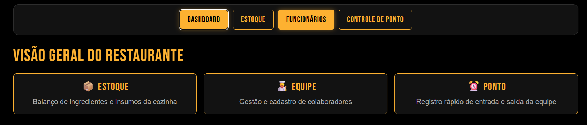

* **Menu inicial:** Ponto central de navegação do sistema de gestão.
* **Gerente:** Acesso total a todas as funções e configurações.
* **Copeiro:** Visualiza e edita o estoque, sem ver preços ou valores totais.
* **Cozinheiro:** Visualiza o estoque (sem preços), sem permissão de edição.
* **Garçom:** Acesso limitado ao dashboard operacional.

As permissões de cada cargo ficam guardadas no banco de dados (tabela `permissao_cargo`), e o backend as confere em cada requisição — esconder uma aba no HTML não substitui essa checagem.

---

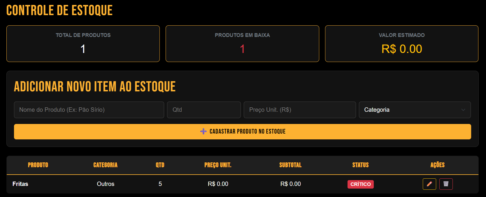

---

> ℹ️ **Acesso aos Painéis Internos:**
> Para consultar os dashboards operacionais, controle de ponto e gestão de estoque, é preciso ter o backend rodando (veja *Instruções de Instalação e Execução do BackEnd*) e fazer login pela página `login.html`.

---

# Backend & Base de Dados

O backend é uma API em **Flask (Python)** com banco de dados **SQLite**. O próprio Flask também serve o site (HTML, CSS, JS e imagens), então site e API ficam no mesmo endereço.

**Diagrama da Base de Dados (modelo entidade-relacionamento)**

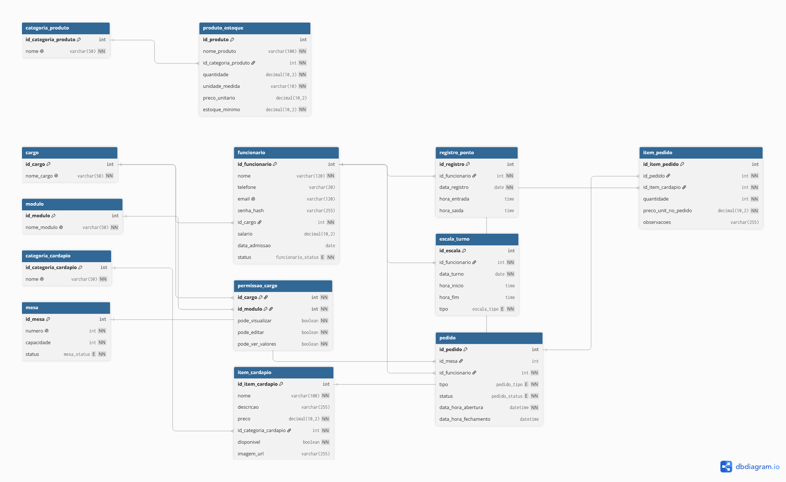

**Diagrama de Classes (modelo de domínio)**

As classes em cinza (Mesa, Pedido, ItemPedido e EscalaTurno) são módulos ainda não definidos pela equipe.

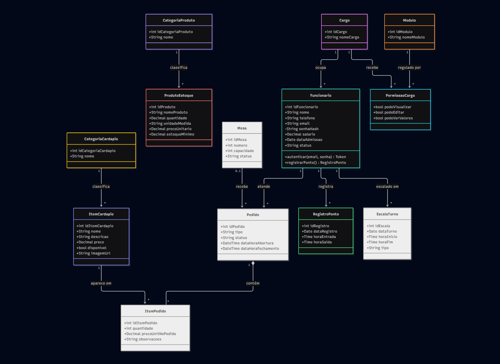

# Primeiros comandos Back-End

**1. Localizando no terminal o local da pasta `backend`**

código:

 ```text
   cd LocalDoArquivo
   ```

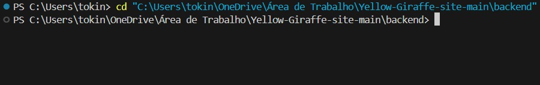

**2. Inicializando o servidor do Flask**

```text
   python app.py
   ```
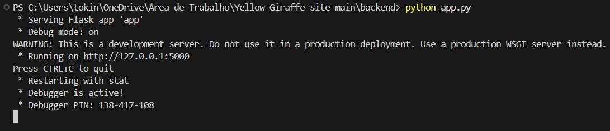

**3. Cadastro (Abra um novo terminal, sem fechar o que já está rodando)**

```text
   cd LocalDoArquivo
   ```

```text
   python criar_usuario.py
   ```

Em seguida, será exibida uma tela de cadastro:

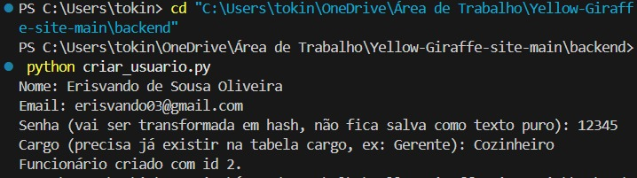

**4. Os dados são salvos no banco SQLite (`backend/yellow_giraffe.db`).** Para consultar a tabela de funcionários direto pelo terminal:

```text
   python -c "import sqlite3; [print(r) for r in sqlite3.connect('yellow_giraffe.db').execute('SELECT id_funcionario, nome, email, id_cargo FROM funcionario')]"
   ```

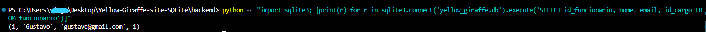
Se preferir uma interface gráfica, abra o arquivo `yellow_giraffe.db` no [DB Browser for SQLite](https://sqlitebrowser.org/) (gratuito).

**5. Login:**

```text
   $resp = Invoke-RestMethod -Uri "http://localhost:5000/api/login" -Method Post -ContentType "application/json" -Body '{"email":"Seu email","senha":"Sua senha"}' ; $token = $resp.token
   ```

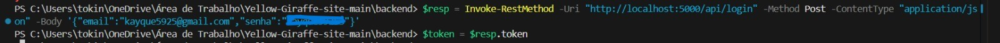

# Manipulando Dados

**1. Add item no estoque:**

```text
   Invoke-RestMethod -Uri "http://localhost:5000/api/estoque" -Method Post -Headers @{ Authorization = "Bearer $token" } -ContentType "application/json" -Body '{"nome_produto": "Batata Frita", "id_categoria_produto": 1, "quantidade": 30, "unidade_medida": "kg"}'
   ```

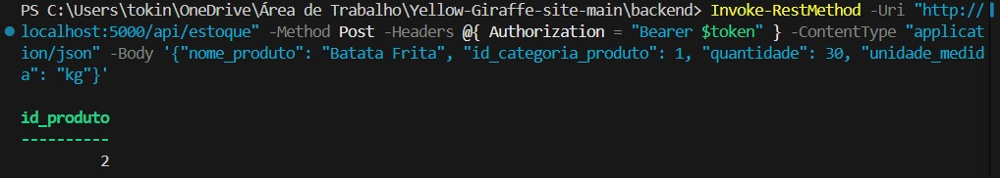

**2. Consultando itens no estoque:**

```text
   Invoke-RestMethod -Uri "http://localhost:5000/api/estoque" -Method Get -Headers @{ Authorization = "Bearer $token" }
   ```

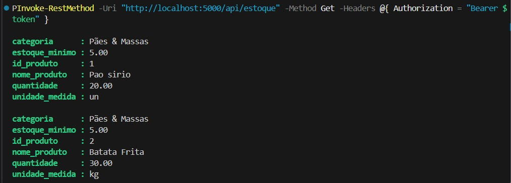

**3. Consultando itens no estoque:**

```text
   python -c "import sqlite3; [print(r) for r in sqlite3.connect('yellow_giraffe.db').execute('SELECT * FROM produto_estoque')]"
   ```


## Endpoints da API

| Módulo | Rotas |
|---|---|
| Autenticação | `POST /api/login`, `POST /api/cadastro` |
| Estoque | `GET/POST /api/estoque`, `PUT/DELETE /api/estoque/<id>` |
| Funcionários | `GET/POST /api/funcionarios`, `PUT/DELETE /api/funcionarios/<id>` |
| Ponto | `POST /api/ponto` (primeira chamada do dia = entrada, segunda = saída) |
| Cardápio | `GET/POST /api/cardapio/categorias`, `PUT/DELETE /api/cardapio/categorias/<id>`, `GET/POST /api/cardapio/itens`, `PUT/DELETE /api/cardapio/itens/<id>` |

Todas (exceto login e cadastro) exigem o cabeçalho `Authorization: Bearer <token>`.

# 📋Tarefas

### 🧹 Limpeza e Ajustes de Escopo
- [X] Remover temporariamente as abas **RH**, **Mesas** e **Pedidos** (aguardando definição futura).

---

### 📦 Módulo de Estoque
- [X] Tornar o campo **Preço Unitário** não obrigatório no cadastro de produtos.
- [X] Ocultar a coluna/valores de preços e valor total para o cargo de **Copeiro**.
- [X] Permitir a visualização de preços e totais financeiros exclusivamente para o **Gerente**.
- [X] Restringir a permissão de alteração (adicionar, editar, excluir itens) apenas para **Gerente** e **Copeiro** (outros cargos apenas visualizam).

---

### 👥 Módulo de Funcionários
- [X] Ocultar a aba e o acesso a **Funcionários** para todos os cargos, deixando visível somente para o **Gerente**.

---

### 🗄️ Autenticação & Banco de Dados
- [X] Implementar sistema de login com validação de credenciais e identificação de cargos.
- [X] Conectar banco de dados centralizado para persistência de logins e dados operacionais (estoque, funcionários, dashboard).
- [X] Desenvolver tela de cadastro.
- [X] Autenticação de login.
- [X] Realizar cadastro.
- [X] Bloquear o cargo definido ao logar no Dashboard.
- [X] Persistência de dados para estoque.
- [X] Persistência de dados para funcionários.
- [X] Migrar o banco de MySQL para SQLite (hospedagem gratuita sem servidor de banco).
- [X] Cadastrar as permissões dos cargos **Garçom** e **Cozinheiro**.
- [X] Backend do **Cardápio** (CRUD de categorias e itens, com permissões por cargo).

### 🚧 Pendente
- [ ] Integrar o módulo de **Ponto** do dashboard à API (`/api/ponto`); hoje a tela ainda usa `localStorage`.
- [ ] Criar a tela de **Cardápio** no dashboard, consumindo as rotas `/api/cardapio/...`.
- [ ] Colocar no ar o site (PythonAnywhere).

---

### 💡 Ideia Futura: Escala & Turnos da Equipe

- [ ] **Quadro Interativo de Escalas:** Substituir o controle de ponto por uma tabela visual com os turnos de trabalho e dias de folga de cada colaborador.
- [ ] **Controle de Acesso da Escala:** Permitir a visualização de turnos para toda a equipe, mas restringir a edição e alterações apenas para usuários autorizados (ex: Gerente).

---

### 📥 Como Baixar o Projeto

#### 1. Fazer o Download do Projeto
1. Acesse a página do projeto: [Repositório Yellow Giraffe](https://github.com/kayquevo/Yellow-Giraffe-site).
2. Clique no botão verde **`<> Code`** no canto superior direito.
3. No menu que se abrir, clique em **`Download ZIP`**.

#### 2. Descompactar a Pasta
1. Abra a sua pasta de **Downloads** e localize o arquivo baixado (`Yellow-Giraffe-site-main.zip`).
2. Clique nele com o botão direito do mouse e selecione **"Extrair Tudo..."**

#### 3. Ver só as páginas institucionais (sem backend)
Dê **dois cliques** em **`index.html`** dentro da pasta descompactada. Isso mostra a Home, Onde Estamos e Especialidades. Para usar a **Área do Funcionário** (login, estoque, funcionários), siga as instruções do backend abaixo.

---

### 🛠️ Instruções de Instalação e Execução do BackEnd

**Pré-requisito:** Python 3.10 ou superior. Não é preciso instalar MySQL nem nenhum servidor de banco: o SQLite já vem embutido no Python.

Todos os comandos abaixo são rodados no terminal (PowerShell, CMD ou o terminal integrado do VS Code), dentro da pasta `backend`:

```bash
cd backend
```

**1. Instalar as bibliotecas** (Flask, flask-cors, PyJWT):

```bash
pip install -r requirements.txt
```

**2. Criar o banco de dados** a partir do schema (cria o arquivo `yellow_giraffe.db`, já com cargos, módulos e permissões):

```bash
python -c "import sqlite3; sqlite3.connect('yellow_giraffe.db').executescript(open('database/yellow_giraffe_schema_sqlite.sql', encoding='utf-8').read())"
```

> Esse comando serve só para criar o banco do zero. Para recomeçar, apague o arquivo `yellow_giraffe.db` e rode de novo. O arquivo `.db` **não** vai para o GitHub (cada pessoa cria o seu).

**3. Criar um usuário para fazer login:**

```bash
python criar_usuario.py
```

Informe nome, e-mail, senha e cargo (`Gerente`, `Copeiro`, `Garçom` ou `Cozinheiro`). Para criar de uma vez um usuário de teste de cada cargo (menos Gerente, senha `teste123`), use `python criar_usuarios_teste.py`.

**4. Iniciar o servidor:**

```bash
python app.py
```

**5. Abrir o site:** acesse **http://localhost:5000** no navegador e entre pela página de login.

> **Segurança:** a chave que assina os tokens de login (`JWT_SECRET`) vem da variável de ambiente de mesmo nome. O valor padrão do `config.py` serve só para testes locais; no site publicado, defina uma chave própria, longa e aleatória, e nunca a escreva no código.
